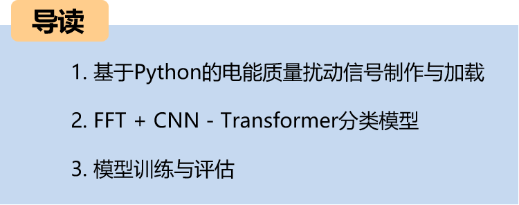
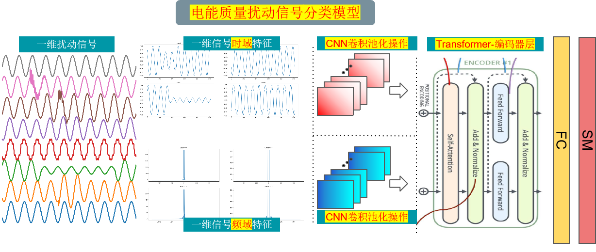
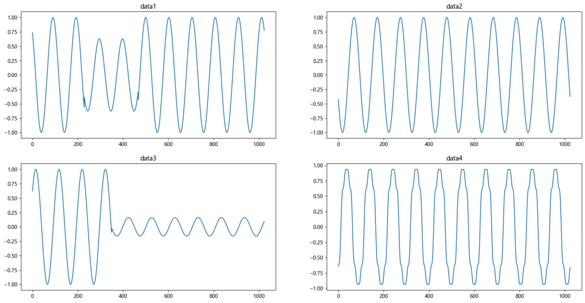
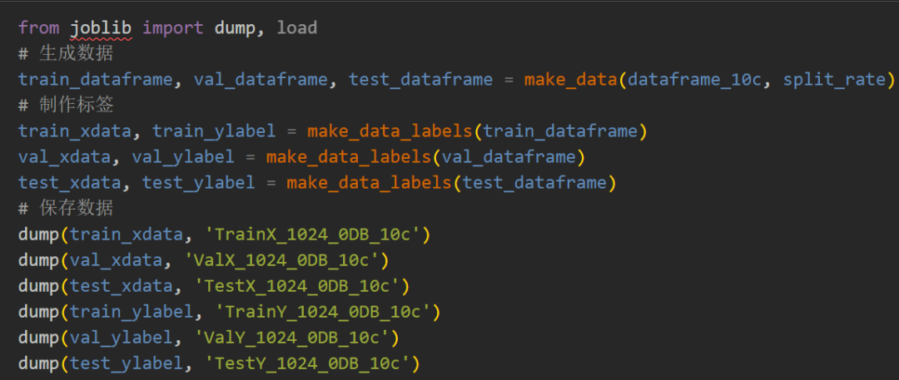
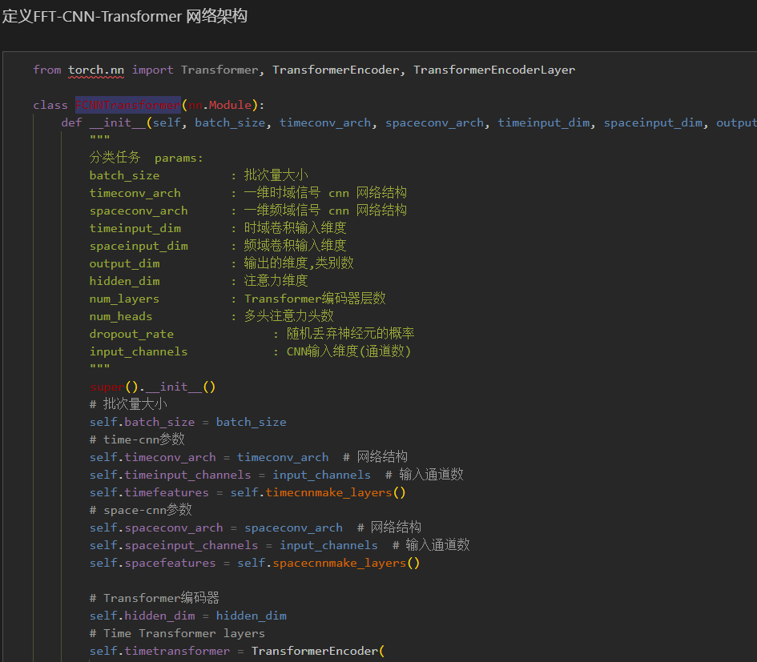
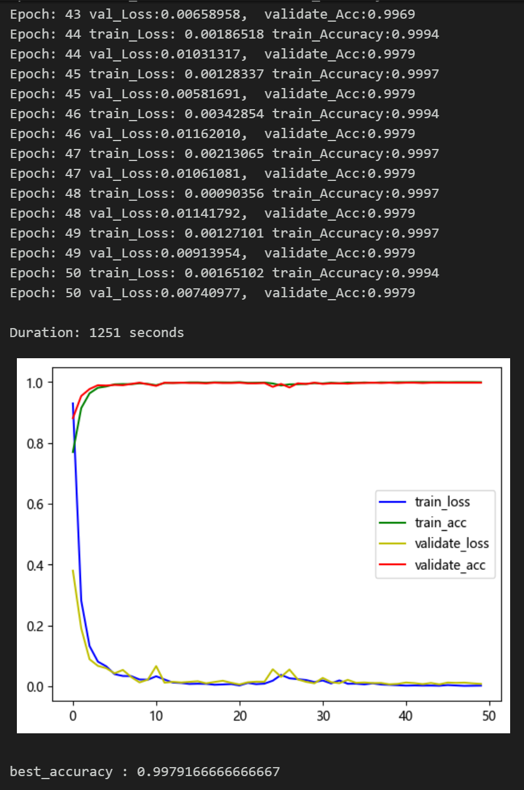
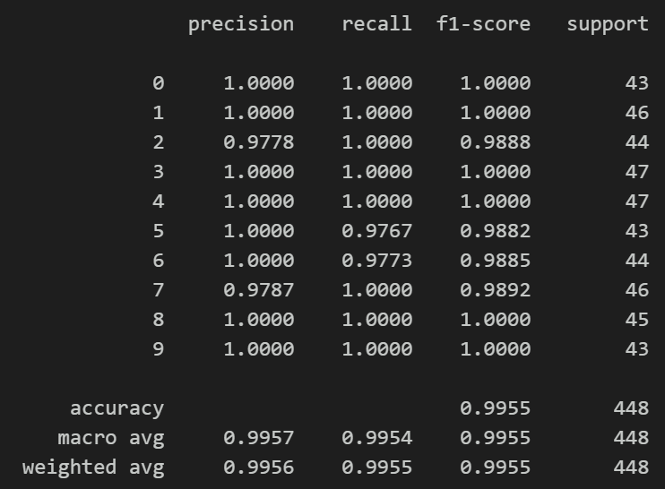
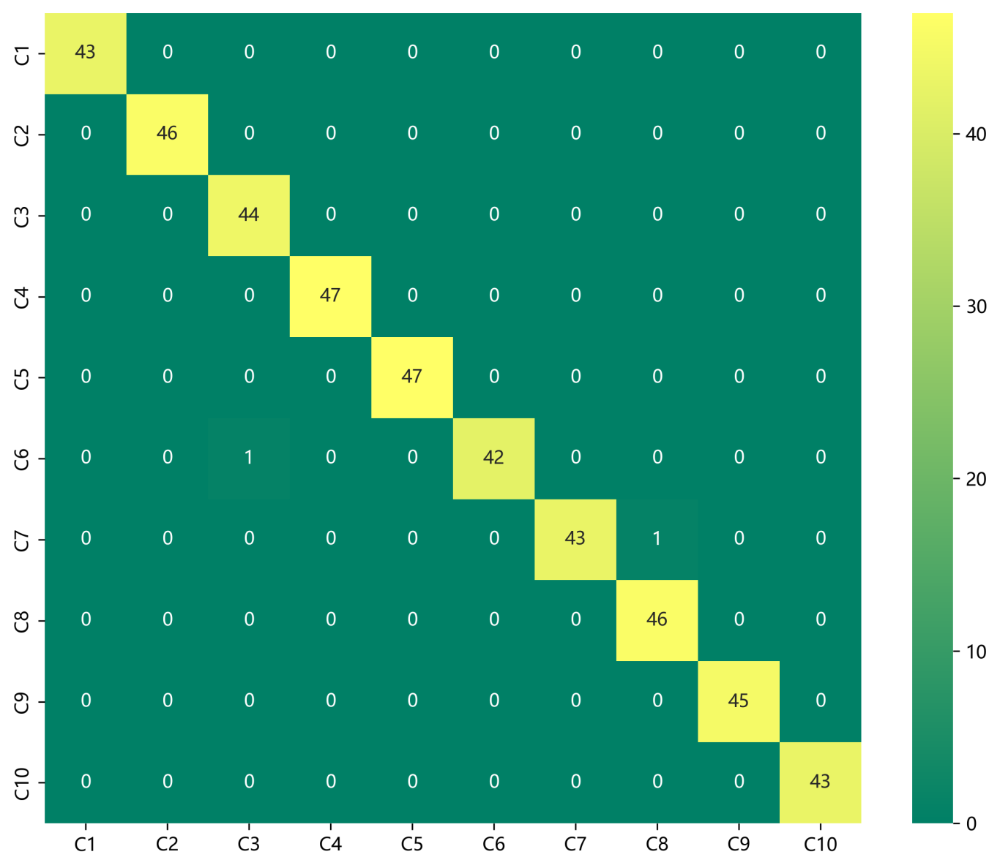
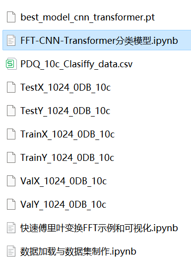

# Power Quality Disturbance Identification Model Based on FFT + CNN - Transformer Time-Domain and Frequency-Domain Feature Fusion

The family set includes the following content:
- Complete dataset of power quality disturbance signals, including well-generated ten-class disturbance signal datasets, categorized data, and label sets, all of which can be run.
- Code for data preprocessing, as well as code for the FFT+CNN-Transformer classification model.
Environment: Python 3.9
Preface
This article introduces the FFT for fast Fourier transform (FFT) and data preprocessing of power quality disturbance signals based on Python simulations. Finally, it implements a CNN-Transformer fusion model for classifying power quality disturbance signals using Python through FFT. For more detailed information about Python simulation power quality disturbance signals, please refer to the following text (Appendix with 10 classification datasets at the end):
Some waveform diagrams of some types of disturbance signals are as follows:
Overall structure of the model
The overall structure of the model is as follows: The one-dimensional fault signal undergoes FFT transformation in the frequency domain features and the signal itself's time domain features respectively through CNN convolutional pooling operations to extract global features. Then, it is further processed by Transformer to extract temporal features, enhancing the fused features. Finally, it goes through fully connected layers and softmax to output classification results.
1 Introduction to Fast Fourier Transform (FFT)
Fourier transform is a tool for signal processing and spectral analysis, used to convert a signal from the time domain to the frequency domain. Fast Fourier Transform (FFT) is an efficient algorithm for implementing Fourier transform, especially suitable for the processing of discrete signals.
First step, import some data, visualize disturbance signals
Second step, visualize disturbance signals through FFT
2 Data Preprocessing of Power Quality Disturbance
- Import data
Based on the reference to IEEE Std1159-2019 Power Quality Detection Standards and related literature, a model for disturbance signals has been constructed, generating ten types of single signals and various composite disturbance signals. Following previous articles, the preprocessing for the 10-class classification of disturbance signals is conducted:
Step 1: Generate a single signal according to the formula model.
Single disturbance signal visualization:
\t  
2.2 Dataset Production
\tCreating the dataset and classification labels
3. Bearing Fault Identification Model Based on FFT+CNN-Transformer
\t3.1 Network Definition Model
\tNote: The input perturbation signal data shape is [64, 1024], batch_size=64, where 1024 represents the sequence length.
3.2 Set parameters and train the model
50 epochs, with an accuracy nearing 100%. The FFT+CNN-Transformer hybrid network model has significantly improved classification results. The model is capable of fully extracting the spatial and temporal features as well as frequency domain features from bearing fault signals. It converges quickly and exhibits superior performance. To date, it is the most accurate method among the previous articles' methods.
\tNote: Adjust parameters.
\tIt is appropriate to increase the number of CNN layers and the dimensionality of hidden layers, and fine-tune the learning rate.
\tChange the hidden dimension and number of layers in Transformer, increase more epochs (note to prevent overfitting)
\tThe shape of a one-dimensional signal stack can be changed (by setting the appropriate length and dimensions).
\t  
\t  
3.3 Model Evaluation
Accuracy, Precision, Recall, F1 Score
\tClassification confusion matrix:

## Images

<!-- PAYMENT_BLOCK -->

## Get this dataset

- Payment link (Stripe): [Buy now](https://buy.stripe.com/3cs8yP7sY87d0vu9AB)
- Payment QR code: 

<!-- /PAYMENT_BLOCK -->
